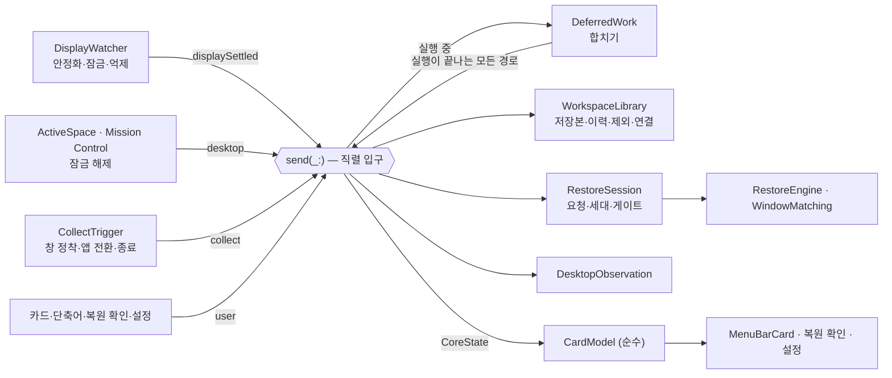

# Plugback 재설계 검토안 — 디자인·정보 구조·코어 로직

> 2026-10-20 · 작성: Claude(디자인 서브에이전트) · 기준 커밋 `e03bd57`(`refactor/redesign-product-logic`, 작업 트리 깨끗한 상태)
>
> **상태: 제안.** 이 문서는 기존 문서(CONTEXT·MINIMAL_REQUIREMENTS·FUNCTIONAL_SPEC·SPACE_LAYOUT_STATE_REVIEW 등)를 확정 변경하지 않는다. 앱 구현도 바꾸지 않았다. 재현 테스트는 저장소 밖 임시 복사본에서만 돌렸다(부록 A).

**읽는 법**

- 구분 표기: **[약속]** 사용자에게 문서로 한 약속 · **[불변식]** CONTEXT·FUNCTIONAL_SPEC·D1–D9로 확정된 도메인 규칙 · **[제안]** 이 문서의 새 제안(미확정). 표시가 없는 「현행」은 지금 구현을 뜻한다.
- 근거 등급: `재현` 임시 복사본 테스트로 현재 동작 확인 · `코드` 코드 읽기로 확인(실행 재현 안 함) · `문서` 문서 대조.
- 문서 우선순위(요청 지시): CONTEXT.md > MINIMAL_REQUIREMENTS > FUNCTIONAL_SPEC > SPACE_LAYOUT_STATE_REVIEW > 그 밖의 문서·README.
- 용어는 CONTEXT.md를 따른다. 요청의 「부분 복원」은 CONTEXT에서 「선택 복원」의 금지어이므로 여기서는 **「남은 항목이 있는 복원 요청」**이라 부른다. 카드의 UI 구성 4종은 「레이아웃」과 섞이지 않게 **카드 구성**이라 부른다.

---

## 0. 요약

1. **도메인 모델(D1–D9)은 건강하다. 고칠 곳은 모델 바깥 세 군데다** — ① 이벤트·진행 상태의 소유권, ② 화면 중심으로 남은 표현, ③ 서로 어긋난 약속 문서.
2. 실제 문제 5개(§2) 중 3개는 재현 테스트 5건으로 현재 동작을 확인했다: 원시 화면 변경 뒤 「화면 연결 확인 중」 고착, 복원 실행 중 Space 전환 유실, 「남은 창 복원」 중 화면 추가 시 새 작업 환경 자동 복원 누락, 이전 작업 환경 결과가 다음 환경 카드에 남음, 다른 환경의 외장 화면에 놓였던 창의 닫힘 맥락 소실(D9).
3. **정보 구조**: 카드의 1급 객체를 화면에서 **작업 환경**으로 올린다. 헤더·복원 소스·요청·결과를 모두 작업 환경 단위로 보이고, 요청 패널은 남은 항목이 있을 때만 연다(§3).
4. **외형**: 안 1 「시스템 패널」(네이티브·단일 카드 구성·색은 상태에만)을 추천한다. 안 2 「요청 원장」의 저장 창별 원장은 「복원 확인」 창에만 빌려온다(§4).
5. **코어**: 엔진·저장소·`RestoreSession`은 그대로 둔다. 컨트롤러에 흩어진 진행 플래그를 **직렬 입구 하나 + 실행 중 도착 이벤트를 합쳐 두는 지연 작업 집합**으로 바꾸고, 카드 파생 계산(약 400줄)을 순수 투영으로 분리한다(§5).
6. 사용자 결정 3개(§7): 자동 저장과 「분리 시 무동작」 약속의 정리, 카드 구성 4종·색 4종의 축소, 메뉴바 글리프의 정적 상태 표시 허용 여부.

---

## 1. 손실 금지 목록 — 약속과 불변식

§3–§6의 모든 제안은 아래 표를 깨지 않는다. 각 제안은 이 표의 번호로 무엇을 지키는지 밝힌다.

| # | 구분 | 내용 | 근거 |
|---|---|---|---|
| I1 | 불변식 | 작업 환경 = 연결된 외장 화면 식별자 집합. A+B와 A 단독은 별개이며 서로의 저장본을 대신 쓰지 않는다. 연결 순서·배치·해상도·포트는 키가 아니다 | CONTEXT `작업 환경`(15행), F-01.1, D5 |
| I2 | 불변식 | 내장 화면의 창은 저장하지 않고 창·Space를 옮기지 않는다. 안내용 읽기만 허용 | CONTEXT `내장 화면`(19행), F-02.8 |
| I3 | 불변식 | 제외한 앱·저장하지 않은 창은 어느 화면에서든 불변. 제외해도 창 위치 기록은 남는다 | CONTEXT `앱 선택`(70행)·`대상 앱`, F-03.3, F-02.8 |
| I4 | 불변식 | 선택 복원만 한다. 전체 스냅샷 덮어쓰기 없음 | CONTEXT `선택 복원`·`전체 스냅샷`, MINIMAL §4 |
| I5 | 불변식 | 복원 소스 = 그 작업 환경의 마지막 저장 완료본(수동·자동 무관). 요청 시작 때 고정하며 이력·다른 환경과 섞지 않는다 | CONTEXT `복원 소스`, F-02.1, D2 |
| I6 | 불변식 | 수집 ≠ 저장. 수집은 저장 대기 이력과 창 연결·닫힘만 갱신하고 파일·복원 기준을 바꾸지 않는다. 자동 저장 OFF에서도 연결·닫힘 판정은 돈다 | CONTEXT `수집`(105행), F-03.5–3.6 |
| I7 | 불변식 | 자동 저장(최초 ON)은 환경 이탈·정상 종료 전에만 저장 완료. 같은 내용은 생략, OFF는 이력 폐기·저장본 유지 | CONTEXT `자동 저장`(113행), D2·D7 |
| I8 | 불변식 | 방문 대기·이동 안내: 시간 제한·대기용 타이머·주기 조회 없음. Space 전환·Mission Control 닫힘 이벤트에서 재판정하고 「남은 복원 취소」로 끝낸다 | CONTEXT(141·145행), F-02.6, D8 |
| I9 | 불변식 | 확인 필요는 「남은 창 복원」으로만 재판정. 늦은 관찰로 자동 재개하지 않는다 | CONTEXT(149행), D8 |
| I10 | 불변식 | 잠금 보류: 미전송 조작만 멈추고, 잠금 해제 확인 뒤 같은 환경의 유효한 남은 항목만 고정 소스로 재개. 판정 불가는 해제로 보지 않는다 | CONTEXT(153행), F-01.3, F-02.6 |
| I11 | 불변식 | 개별 Spaces OFF·판정 불가면 새 Space 기록의 저장·복원을 보류하고 안내. 평면 복원으로 조용히 강등하지 않는다 | CONTEXT(47행), F-01.5, D6 |
| I12 | 불변식 | Plugback 실행·재실행은 복원을 시작·재개하지 않는다 | F-01.1, D8 |
| I13 | 불변식 | 같은 환경에서 닫힌 자리는 그 환경의 다음 저장 성공까지 제외(파일 보존). 다른 환경·연결 해제 중 닫힘은 기록 유지·다시 열기 옵션, 닫힘 맥락 불명은 실행·생성 보류 | CONTEXT(82행), F-03.6, F-02.4, D9 |
| I14 | 불변식 | 파일 기록 성공 뒤에만 새 저장본 공개. 읽기 실패·이후 버전은 첫 실행으로 위장하지 않고 모든 쓰기를 동결 | CONTEXT `저장`(100행), F-04.2 |
| I15 | 불변식 | 실험실은 모두 최초 OFF, 부모 OFF는 앱 실행·창 생성 전체 차단, 실행·생성 직전에 최신 설정 확인 | F-08, D9 |
| I16 | 약속 | 꺼진 앱은 기본 구성에서 실행하지 않는다 | MINIMAL 나, US-004 |
| I17 | 약속 | 손쉬운 사용 권한 하나만. 화면 기록 권한 없음 | MINIMAL §4, F-06.1 |
| I18 | 약속 | 상시 폴링·주기 타이머 없음 | F-07, BRANDING §2 |
| I19 | 약속 | 자동 복원은 확인 팝업 없이(선택 복원이기 때문). 탭·문서 내용 복구 없음. 진단 기록 자동 전송 없음 | MINIMAL 마, F-05.8, SPACE_LAYOUT_STATE_REVIEW 3.6 |
| I20 | 약속 · **충돌** | 「분리 시 무동작 · 수동 저장을 앱이 대신 하지 않음」은 I7과 정면으로 어긋난다 → §2 P1, §7 결정 1 | MINIMAL:74–76, BRANDING:23·25, US-005 AC-5 |

---

## 2. 실제 제품 문제 5가지

| # | 문제 | 심각도 | 근거 등급 |
|---|---|---|---|
| P1 | 약속 문서가 서로 어긋나 제품이 무엇을 약속하는지 모호하다 | 높음 | 문서 |
| P2 | 실행·안정화 중 도착한 이벤트가 상태 기계 밖에서 사라진다 | 높음 | 재현 3 + 코드 |
| P3 | 화면 중심 표현이 작업 환경 규칙을 가린다 | 중간 | 재현 1 + 코드 |
| P4 | 다른 환경의 외장 화면에 놓였던 창은 D9 닫힘 맥락을 잃는다 | 중간(실험실 사용자) | 재현 1 + 대조 1 |
| P5 | 저장 소유권이 흩어져 실패 처리의 의미가 경로마다 다르다 | 중간 | 코드 |

### P1. 약속 문서가 서로 어긋난다 — `문서`

- **증상**: 기본값(자동 저장 ON)에서 케이블을 뽑으면 저장 대기 이력이 그 작업 환경의 새 저장본이 되고, 사용자가 앞서 누른 수동 저장을 복원 소스에서 대체한다(I5·I7). 그런데 여러 문서는 반대를 약속한다.
- **근거**
  - `docs/MINIMAL_REQUIREMENTS.md:43–49`(라: 자동 저장 최초 켜짐, 환경 이탈 때 저장) ↔ 같은 문서 `:74–76`(§4 비목표: 「수동 슬롯을 앱이 대신 저장하지 않는다」, 「기본 구성에서 … 외장 화면이 분리될 때 아무 동작도 하지 않는다」, 「유일한 예외가 실험실 · 자동 슬롯 — 기본 꺼짐」).
  - `docs/BRANDING.md:23`(「분리 시 무동작」), `:25`(「실험실 · 자동 슬롯 … 수동 저장을 앱이 대신 하지 않는다는 약속은 그대로다」).
  - `docs/user-stories/US-005-protect-builtin-screen.md:35–39`(AC-5 분리 시 무동작, 자동 슬롯 예외) ↔ `docs/user-stories/US-013-auto-save.md`(최초 켜짐, AC-1 뽑기 직전 배치가 저장본).
  - `README.md:15`(「keeps a profile per display」), `:99`(CONTEXT가 profile 용어를 정한다고 안내) ↔ CONTEXT `작업 환경 저장본`의 금지어 「프로필」. UI 문구도 「프로필에서 삭제」다(`App/Plugback/CardComponents.swift:147–154`, `:305`).
- **영향**: 사용자가 기대할 동작(「뽑아도 아무것도 안 한다」 vs 「뽑을 때 저장한다」)이 문서마다 다르고, 리뷰·테스트 기준도 흔들린다. D2가 2026-09-11에 확정된 최신 규칙(SPACE_LAYOUT_STATE_REVIEW 7장)이므로 나머지가 낡은 서술로 보이지만, 공개 README와 브랜드 원칙은 사용자 약속이므로 정리 방향은 사용자 결정이다(§7 결정 1).

### P2. 이벤트가 상태 기계 밖에서 사라진다 — `재현` 3건 + `코드`

| 증상 | 근거 | 등급 |
|---|---|---|
| 해상도·배치 변경, 덮개 여닫기처럼 외장 화면 집합이 그대로인 원시 변경 뒤 카드에 「화면 연결 확인 중」이 **계속 남는다**. 카드를 다시 열어도 남는다 | 원시 변경마다 `isSettlingScreens = true`(`Sources/PlugbackKit/PlugbackController.swift:628`), 해제는 `workspaceChanged()`에서만(`:738`). DisplayWatcher는 집합이 같으면 콜백 없이 끝난다(`Sources/PlugbackKit/DisplayWatcher.swift:107–121`, 주석 `:7–8`). 표시는 `App/Plugback/MenuBarCard.swift:79`, `:149–152` | 재현 T1 |
| 복원 실행 중 사용자가 방문 대기 Space로 옮기면 그 이벤트가 **버려져**, 그 Space가 현재인데도 「방문 대기」로 남는다. 다음 Space 이벤트가 와야 복원된다 | `pendingSpaceRefresh`는 `PlugbackController.swift:975`·`:986`에서 켜고 `:1011`·`:1036`에서 끄기만 한다 — 읽는 곳이 없다 | 재현 T2 |
| 「남은 창 복원」 실행 중 화면이 추가되면 옛 요청은 취소되지만 **새 작업 환경의 자동 복원이 시작되지 않는다**(A+B 저장본이 있어도) | `pendingWorkspaceRestart`(`:757`)는 `performRestore` 루프(`:1015–1028`)만 소비하고 `performResume`(`:1034–1042`)은 보지 않는다 | 재현 T5 |
| 잠자기 해제 직후(초기값 2.5초) 화면 추가가 억제되면 컨트롤러는 통지를 받지 못한다 — 떠나는 환경 저장(D2)·새 환경 선택·옛 요청 취소가 다음 변화까지 미뤄지고, 카드는 다른 환경 요청의 남은 항목을 「남은 창 복원」 버튼과 함께 보일 수 있다 | 억제 시 반환(`DisplayWatcher.swift:126`). `waitingItems`·`hasOpenRestoreItems`는 요청 키를 확인하지 않고(`PlugbackController.swift:484–496`), `resumeRemaining`은 키가 다르면 조용히 반환한다(`:944`) | 코드 |

- **원인**: 진행 상태가 `isRestoring`과 Bool 플래그 3개(`isSettlingScreens`·`pendingSpaceRefresh`·`pendingWorkspaceRestart`, `PlugbackController.swift:74`, `:555–556`)로 흩어져 있고 소비 지점이 실행 경로마다 다르다. DisplayWatcher는 화면별 프로필 시절의 「등장/제거」 콜백(`DisplayWatcher.swift:117`, `:128`)만 내고 「안정화했지만 바뀌지 않음」·「억제함」을 알리지 않는다 — 작업 환경 모델(D5)이 필요로 하는 「작업 환경 키가 X에서 Y로 안정됨」이라는 사건이 없다.
- **영향**: US-009 AC-2·AC-4(덮개·해상도 뒤 영구 상태 문구), I8(방문 대기는 Space 전환에서 재판정), US-001 AC-7·G05(순차 연결 전환).

### P3. 화면 중심 표현이 작업 환경 규칙을 가린다 — `재현` 1건 + `코드`

| 증상 | 근거 | 등급 |
|---|---|---|
| A+B에서 복원한 뒤 B를 뽑아 저장본 없는 A 단독 환경이 되면, A 카드에 「이 화면 조합의 저장본이 없어요」와 **A+B 요청의 「마지막 복원」이 함께** 보인다 | 결과를 화면 ID로 보관(`PlugbackController.swift:169`, `:1050–1059`)하고 카드가 화면 ID로 꺼낸다(`:345`, `:462–464`). 모델 주석도 화면 단위를 전제한다(`Sources/PlugbackKit/Model.swift:248–251`) | 재현 T4 |
| 기본 카드 구성(A · 상태 카드)에서 외장 화면이 둘 이상이면 카드 첫 화면에 **복원 소스 줄이 없다**. 「대상 앱 관리」 안에서만 화면마다 같은 값이 반복된다 | `MenuBarCard.swift:343–345`(화면 하나일 때만), `:84–88`(요약에는 없음), `:458–460`(관리 화면). US-013 AC-3, SPACE_LAYOUT_STATE_REVIEW `:358`(「복원 버튼은 어느 시점의 어떤 저장본을 적용하는지 보여줘야 한다」) 미충족 | 코드 |
| 기억만 상태의 헤더는 화면 하나로 작업 환경을 대표한다 — 분리 직후엔 식별자순 첫 화면, 재실행 직후엔 이름순 첫 저장본의 첫 화면. A+B를 떠나도 이름 하나만 보인다 | `PlugbackController.swift:782–790`, `WorkspaceLibrary.swift:84–86`, `Model.swift:85–93` | 코드 |
| 되돌릴 수 없는 삭제가 한 번 클릭이다: 제외 앱 행의 ⊗(「프로필에서 삭제」), 「복원 확인」 창의 「이 자리 삭제」 | `App/Plugback/CardComponents.swift:140–155`, `App/Plugback/RestoreConfirmationView.swift:65`. BRANDING §2 「되돌릴 수 없는 명시적 삭제는 한 번 묻는다」와 어긋남 | 코드 |
| 표현의 노력이 상태 명확성보다 앞선다: 카드 구성 4종 × 색 4종 × 밝기 2 = 32조합, 설정 창은 「모양」으로 열린다 | `App/Plugback/CardAppearance.swift:20–25`·`:79–80`, `App/Plugback/SettingsView.swift:15`, `docs/THEME_DIRECTIONS.md` | 코드·문서 |

- **원인**: 화면별 프로필(M3) 시절의 표현 단위가 작업 환경 모델(2026-09-11) 뒤에도 남았다. 컨트롤러가 카드 파생 계산(`PlugbackController.swift:173–535`, `:1085–1138`, 약 400줄)까지 맡아 화면 단위 가정이 코어 안에 박혀 있다.

### P4. 돌아다닌 창은 D9 닫힘 맥락을 잃는다 — `재현` 1건 + 대조 1건

- **증상**: 회사 저장본에 있는 Slack 창을 집 외장 화면에 두고 작업한 뒤 집에서 Slack을 종료하면, 회사로 돌아왔을 때 「종료된 앱 다시 열기」가 켜져 있어도 Slack을 실행하지 않고 「확인 필요 · 닫힌 시점을 알 수 없음」으로 남는다. SPACE_LAYOUT_STATE_REVIEW `:407`의 예시(「집에서 Slack을 종료했더라도 … 회사 모니터로 돌아왔을 때 위쪽 설정이 ON이면 Slack을 실행한다」)와 다르다.
- **근거**: 창 연결은 전역에서 「창 하나 = 저장 자리 하나」다. 집 수집이 같은 창을 집 자리에 연결하면 회사 자리의 연결을 **지운다**(`Sources/PlugbackKit/WorkspaceLibrary.swift:319–328` `adoptLinks`, `:303–308` `confirmLink`). 연결이 없으니 닫힌 환경을 기록할 곳이 없고, 엔진은 닫힘 맥락 불명으로 판정한다(`Sources/PlugbackKit/RestoreEngine.swift:254–263`).
- **대조**: 같은 창이 집에서 외장 화면에 관찰되지 않았다면 회사 자리는 `lost(in: 집)`이 되어 기대대로 실행한다(대조 테스트 통과).
- **영향**: 실험실 사용자에게 D9(I13)의 핵심 경로가 집↔회사 왕복이라는 일상 흐름에서 동작하지 않는다. 실험실 OFF(기본)에서는 결과 문구가 같아 드러나지 않는다.

### P5. 저장 소유권이 흩어져 실패 의미가 경로마다 다르다 — `코드`

| 경로 | 현재 | 문제 |
|---|---|---|
| 환경 이탈 자동 저장 | `_ = library.confirm(key: previous)`로 결과를 버린다(`PlugbackController.swift:742`). 쓰기 실패는 범용 `writeFailed` 알림 하나 | 어느 작업 환경이 실패했는지, 그 환경에 다시 연결하면 **이전 저장본으로 복원된다**는 사실이 보이지 않는다. 재시도 경로는 다음 이탈·종료뿐 |
| 정상 종료 | `applicationShouldTerminate`→`prepareForTermination`→`confirmAll`(`App/Plugback/PlugbackApp.swift:65–90`, `PlugbackController.swift:908–915`) **그리고** `willTerminate`→`onTerminating`→`confirmAll`(`Sources/PlugbackKit/ActivityWatcher.swift:59–65`, `PlugbackController.swift:657`) | 「저장하지 않고 종료」를 고른 뒤에도 두 번째 경로가 저장을 다시 시도한다 — 사용자의 선택과 다른 결과가 가능하다 |
| 닫힘 제외·앱 선택 기록 | 쓰기 실패여도 메모리에 공개(`WorkspaceLibrary.swift:183–184`, `:199`, `:255`) | 닫힘 제외는 안전 측 예외로 타당하지만 F-04.2(「새 상태를 메모리에 먼저 공개하지 않고」)에 적혀 있지 않다. 앱 선택의 메모리 공개는 예외로 볼 근거가 없다 |
| 지문 불일치 화면 | 복원은 그 화면을 통째로 건너뛰지만, 수집은 그 화면의 지문을 새 값으로 덮는다(`Sources/PlugbackKit/CaptureEngine.swift:110`, `collectCandidate`에 검사 없음 `PlugbackController.swift:850–896`) | 카드는 「지금 배치가 맞다면 저장을 다시 눌러 갱신하세요」라고 안내하지만, 자동 저장 ON이면 그 환경을 한 번 떠나는 것만으로 보호가 풀린다(미재현·영향 낮음) |

---

## 3. 추천 정보 구조와 플로우

### 3.1 정보 구조 — 작업 환경이 1급 객체 [제안]

카드는 **「지금 작업 환경은 무엇이고, 무엇으로 복원되며, 내가 할 일이 있는가」** 세 질문에 위에서부터 답한다.

| 순서 | 구획 | 내용 | 언제 | 지키는 것 |
|---|---|---|---|---|
| 1 | 헤더 | 작업 환경 이름 = 화면 표시 이름의 조합(「LG Fine 24 (왼쪽 위) + DELL (오른쪽)」), 화면 상태 배지(연결됨·기억만·없음) | 항상 | I1, CONTEXT `화면 상태` |
| 2 | 주 동작 | 「지금 복원」「지금 레이아웃 저장」 — 저장본이 없으면 저장을, 있으면 복원을 강조(현행) | 연결됨 | F-05.2 |
| 3 | 복원 소스 | 「복원 소스 · 자동 · 오후 6:02」 **작업 환경당 한 줄**, 자동 저장 ON이면 저장 대기 줄(현행 문구) | 저장본·이력이 있으면 항상 | I5·I7, US-013 AC-3 |
| 4 | 요청 패널 | 상태 문장 1줄 + 화면별로 묶은 남은 항목 + 「남은 창 복원」「남은 복원 취소」 | 현재 작업 환경의 요청에 남은 항목이 있을 때만 | I8–I10 |
| 5 | 주의 | 저장 실패·저장 차단·개별 Spaces·지문 불일치·권한 회수 — 각각 「무엇이 보존됐나 + 다음 행동」 | 해당할 때만 | I11, I14 |
| 6 | 마지막 복원 | 요약 1줄(펼치면 저장 창별 사유) — **요청의 작업 환경 = 현재 작업 환경일 때만** | 결과가 있을 때 | F-02.9, P3 |
| 7 | 대상 앱 | 「앱 n개 · 창 n개 · Space n개 ›」 → 드릴인: 화면별 3묶음(지금 화면에 있는 앱 / 화면에 없는 저장 앱 / 제외한 앱) | 항상 | I3, F-05.3 |
| 8 | 푸터 | 자동 복원 토글 · 설정 · 종료(현행) | 항상 | F-05.4 |

- 「복원 확인」 창: 현행 유지(사용자가 「창 확인 필요 N개」를 눌렀을 때만 연다). 저장 창별 원장 형태로 다듬는다(§4).
- 설정 창: 일반 · 작업 환경 · 실험실. 작업 환경 행에 복원 소스와 **저장 대기·저장 실패 상태**를 함께 보인다. 「모양」은 결정 2에 따라 없애거나 일반 아래로 내린다.
- 삭제(저장 기록·저장 자리·작업 환경)는 모두 행 메뉴 안에 두고 한 번 확인한다. UI 문구 「프로필에서 삭제」는 「저장 기록 삭제」로 바꾼다.

### 3.2 첫 실행

1. 실행 → 권한 확인. 권한이 없으면 카드 전체를 권한 안내로 바꾼다(현행, I17). 실행만으로 복원하지 않는다(I12). 로그인 시 실행은 최초 켬(F-06.3) — 끌 수 있음을 설정 일반 탭 첫 줄에 보인다.
2. 외장 화면이 없으면: 헤더 「외장 화면 없음」 + 「외장 화면을 연결하면 그 조합이 작업 환경이 됩니다.」
3. 연결됨 · 저장본 없음:
   - 주 동작은 「지금 레이아웃 저장」(현행).
   - 안내 한 문장 [제안]: 「지금 배치를 저장하거나, 자동 저장이 켜져 있으니 이 화면 조합을 떠날 때 지금 배치가 첫 저장본이 됩니다.」 (I7, D2의 첫 저장 두 경로)
   - 대상 미리보기 [제안]: 「저장 대상 · 지금 화면에 있는 앱 n개 — 원치 않는 앱만 끄세요. 내장 화면의 창은 저장하지 않습니다.」 (D4, I2)
   - 개별 Spaces OFF·판정 불가면 저장 버튼을 누르기 **전에** 사유를 보이고 버튼을 비활성으로 둔다(I11).
4. 구버전 `profiles.json`을 이전했으면 한 번 안내한다(현행 `migrationNotice`).

### 3.3 평상시

```
연결 → 1.5초 안정화 → (자동 저장 ON) 떠나는 작업 환경 저장 → 새 작업 환경 선택
     → (자동 복원 · 저장본 있음 · 권한) 복원 요청 시작 → 결과 요약
작업 → 수집(창 정착 · 앱 전환 · 앱 종료 · Space 이벤트 뒤) → 저장 대기 줄 갱신
분리 → 떠나는 작업 환경 저장 → 헤더 「기억만」, 복원 소스 줄 유지
종료 → 저장할 변경이 있으면 저장 → 실패 시 3지선다(다시 시도 · 저장하지 않고 종료 · 취소)
```

- 정보는 카드를 열 때만 보인다. 팝업·포커스 빼앗기 없음(I19). 짧게 끝나는 작업은 진행 표시를 깜빡이지 않는다(SPACE_LAYOUT_STATE_REVIEW 1.1 UX 검토안).
- 수동 저장 직후 일회성 「저장됨 · 앱 n개 · 창 n개」(현행).

### 3.4 남은 항목이 있는 복원 요청 [제안]

요청 패널은 **사용자가 할 일이 있는 항목을 먼저**, 저절로 끝날 항목을 다음에 둔다.

| 항목 상태 | 카드 줄(예) | 끝나는 방법 |
|---|---|---|
| 이동 안내 | 「LG Fine 24 (왼쪽 위) · Space 3 이동 필요 — 내장 화면 → 이 화면, Mission Control에서 옮겨 주세요」 | 사용자가 옮기고 연다 → 방문 대기로 이어져 자동 복원(I8) |
| 확인 필요 | 「DELL (오른쪽) · Slack 창 확인 필요 — 닫힌 시점을 알 수 없음」 + 「창 확인 필요 1개 ›」 | 「복원 확인」 창 → 「남은 창 복원」(I9) |
| 방문 대기 | 「LG Fine 24 (왼쪽 위) · Space 2 방문 대기 — 열면 복원 (Chrome 창 2개)」 | 그 Space를 연다(이벤트, 시간 제한 없음) |
| 잠금 보류 | 「잠금 해제 대기」·「잠금 상태를 확인하지 못해 대기」 | 해제 확인 시 자동, 판정 불가는 「남은 창 복원」(I10) |

- 패널 머리 문장: 「A+B 복원 · 이동 3 · 남음 3」. 가짜 퍼센트·카운트다운은 쓰지 않는다.
- 「남은 복원 취소」는 요청이 열려 있는 동안 항상 보인다. 모든 항목이 끝나면 패널은 「마지막 복원」 한 줄로 접힌다.
- 전제: §5의 이벤트 유실 수정. 실행 중에 Space를 열어도 실행 직후 그 항목이 복원되어야 한다.

### 3.5 오류

| 상황 | 사용자에게 보이는 문장(요지) | 다음 행동 | 보존되는 것 |
|---|---|---|---|
| 권한 없음·회수 | 「손쉬운 사용 권한이 필요합니다」 | 시스템 설정 열기 · 다시 확인 | 저장본 전부. 빈 창 목록으로 저장하지 않음(F-06.2) |
| 저장 파일 읽기 실패·이후 버전 | 「이번 실행에서는 저장하지 않습니다」(현행) | 재시작 · 파일 확인 | 원본 파일(쓰기 동결, I14) |
| 손상 → 백업 후 초기화 | 「손상되어 초기화했습니다」(현행) | 백업 파일 보기 | 백업 |
| 쓰기 실패(수동·이탈·종료) [제안] | 「A+B 작업 환경을 저장하지 못했습니다 · 다음 연결은 오후 6:02 저장본으로 복원됩니다」 | 「다시 시도」 | 마지막 저장본 · 저장 대기 이력 |
| 개별 Spaces OFF·판정 불가 | 현행 안내 문구 | 시스템 설정 | 기존 기록, 평면 강등 없음(I11) |
| Space 관찰 실패(저장 시) | 「Space 상태를 확인하지 못해 저장하지 않았습니다」(현행) | 잠시 후 다시 | 이전 저장본 · 이력 |
| 지문 불일치 | 「화면 정보가 저장 당시와 달라 복원하지 않았습니다」(현행) | 맞다면 「지금 레이아웃 저장」 | 그 화면 기록 — 자동 수집도 멈춤 [제안] |
| 창 생성 실패(실험실) | 「확인 필요 · 앱 실행·창 열기를 요청했으나 창을 확인하지 못함」(현행) | 직접 연 뒤 「남은 창 복원」 | 저장 자리 |
| 종료 전 저장 실패 | 현행 3지선다 | 다시 시도 · 저장하지 않고 종료 · 취소 | 「저장하지 않고 종료」는 실제로 저장하지 않는다 [제안] |

---

## 4. 외형 방향 — 2안 비교와 추천

참고 자료(부록 C)에서는 원칙만 가져왔다: 디자인을 한 문장으로 정하기, 조용한 패널·정렬된 숫자·색은 데이터(여기서는 상태)에만, 모든 상태(빈·진행·성공·오류·비활성) 설계, 빈·오류 상태에는 이유와 다음 행동, 모션은 상태 변화 설명에만, 색은 의미 토큰으로. 웹 랜딩 요소(히어로, 큰 디스플레이 서체, 스크롤 모션, 사진, 그라디언트·글래스 장식)는 가져오지 않는다.

| 기준 | 안 1 · 「시스템 패널」 | 안 2 · 「요청 원장」 |
|---|---|---|
| 한 문장 | 메뉴바에서 내려온 시스템 패널처럼 보이고, 색은 상태에만 쓴다 | 복원 요청을 한 장의 원장으로 — 저장 창마다 한 줄, 상태 칩과 시각 |
| 표면 | MenuBarExtra 기본 재질·시스템 배경, 구획은 구분선 한 줄 | 브랜드 팔레트(그래파이트+앰버) 커스텀 표면·칩 |
| 색 | 시스템 라벨 색, 강조는 시스템 강조 색. 상태 색은 실패=빨강, 사용자 행동 필요=주황 둘뿐. 앰버는 앱 아이콘·글리프에만 | 상태마다 칩 색(이동·대기·확인·실패·취소 등 5색 이상) |
| 서체 | 시스템 텍스트 스타일만 — headline(작업 환경), body(버튼), callout(상태 문장), caption(메타·시각), 숫자는 고정폭 숫자 | 같은 서체 + 칩 라벨 |
| 구성 | 단일 360pt 카드, 4pt 격자(8·12·16), 행 28pt(`@ScaledMetric`) | 440pt 이상(화면/Space 탭 + 원장 목록) |
| 상태 표현 | 문장 + SF Symbol(시계·물음표·화살표·체크·느낌표), 색은 보조 | 칩 + 행 단위 진행 |
| 모션 | 없음. 진행은 작은 ProgressView + 문장 | 행 상태 전환 애니메이션 |
| 접근성 | 표준 컨트롤이라 키보드·VoiceOver·대비 증가·투명도 감소를 OS가 처리 | 커스텀 칩·탭마다 접근성 구현 필요, 색 의존 위험 |
| 유지비 | 구성 1 × 밝기 2 렌더 검사 | 커스텀 컴포넌트·팔레트 조합 검사 증가 |
| 브랜드 적합 | 「조용함·절제」(BRANDING §2)와 일치 | 개성은 강하지만 대시보드처럼 길어짐(창 20개면 20줄) |
| 위험 | 개성이 약해 보일 수 있다 | 「가짜 진행률」 금지(SPACE_LAYOUT_STATE_REVIEW 1.1)와 충돌 소지, 메뉴바 패널 높이 증가 |

**추천: 안 1 「시스템 패널」.** 안 2의 장점(저장 창별 원장)은 이미 별도 창인 「복원 확인」에만 빌려와, 카드는 요약을, 상세 창은 원장을 맡게 나눈다.

**안 1 화면 예시** — 360pt 기준. 기호(▭ ↶ ⇄ ? ◷ !)는 SF Symbols 자리표시다.

```
평상시
┌────────────────────────────────────────────┐
│ ▭ LG Fine 24 (왼쪽 위) + DELL (오른쪽)  연결됨 │
│ [ ↶ 지금 복원                    ] [ 저장 ]  │
│ 복원 소스 · 자동 · 오후 6:02                   │
│ 저장 대기 · 2분 전 배치 — 환경을 떠날 때 저장     │
├────────────────────────────────────────────┤
│ 마지막 복원 · 이동 5 · 건너뜀 1 · 실패 0  3분 전 › │
├────────────────────────────────────────────┤
│ 대상 앱 8개 · 창 11개 · Space 3개             › │
├────────────────────────────────────────────┤
│ ● 자동 복원                       설정   종료 │
└────────────────────────────────────────────┘

남은 항목이 있는 요청 (요청 패널만)
│ A+B 복원 · 이동 3 · 남음 3                    │
│ ⇄ LG Fine 24 (왼쪽 위) · Space 3 이동 필요      │
│   내장 화면 → 이 화면, Mission Control에서 옮겨 주세요 │
│ ? DELL (오른쪽) · Slack 창 확인 필요       확인 › │
│ ◷ LG Fine 24 (왼쪽 위) · Space 2 방문 대기 — 열면 복원 │
│ [ 남은 창 복원 ]  [ 남은 복원 취소 ]            │

저장 실패 (주의 구획)
│ ! A+B 작업 환경을 저장하지 못했습니다.           │
│   다음 연결은 오후 6:02 저장본으로 복원됩니다. [다시 시도] │

첫 실행 · 저장본 없음
│ ▭ LG Fine 24 (왼쪽 위)                저장본 없음 │
│ [ 지금 레이아웃 저장               ] [ 복원 ]   │
│ 지금 배치를 저장하거나, 이 화면 조합을 떠날 때    │
│ 지금 배치가 첫 저장본이 됩니다(자동 저장 켜짐).   │
│ 저장 대상 · 지금 화면에 있는 앱 6개            › │
```

의미 토큰(안 1) [제안]: `text.primary/secondary/tertiary` = 시스템 라벨 색, `accent` = 시스템 강조 색, `status.attention` = systemOrange(이동 안내·확인 필요·저장 실패), `status.failure` = systemRed(이동 실패), `status.waiting` = secondary + 시계 기호, `status.done` = secondary + 체크 기호. 모든 상태는 기호와 문장을 함께 쓰고 색만으로 전달하지 않는다(F-05.7).

---

## 5. 코어 재설계 — Interface · 상태 소유권 · 이벤트 흐름

### 5.1 원칙 [제안]

1. **깊은 모듈은 그대로 둔다**: `WorkspaceLibrary`·`CaptureEngine`·`RestoreEngine`·`WindowMatching`·`SpacePlacement`·`DesktopObservation`·`ProfileStore`·`RestoreSession`(세대 번호·실행 직전 게이트). 기존 테스트 182개와 설계 재현 검사 15개가 이들의 계약을 지킨다.
2. **입구는 하나, 처리는 직렬**: 모든 신호(화면·Space·Mission Control·잠금 해제·수집·사용자 명령·종료)를 한 메서드로 받는다. 한 번에 하나의 실행(저장·복원·재개)만 돈다.
3. **실행 중 도착한 이벤트는 버리지 않고 합친다**: 합친 일은 실행이 끝나는 **모든** 경로에서 같은 순서로 처리한다.
4. **결과·저장 실패·요청은 작업 환경 키를 달고 다닌다**: 화면 ID로 보관하지 않는다.
5. **UI 파생은 순수 함수**: 카드가 그리는 묶음·Space 번호·대기 줄은 코어 상태에서 계산한다. 코어는 문자열을 만들지 않는다(현행 원칙 유지).

### 5.2 Interface 초안

```swift
// PlugbackKit (제안) — 공개 파사드 이름 PlugbackController는 유지한다.
public enum CoreEvent: Sendable {
    case displayChangeBegan                       // 원시 변경: 수집 정지
    case displaySettled(DisplaySettle)            // 안정화 완료 — 바뀌지 않았어도 반드시 온다
    case desktop(DesktopSignal)                   // .activeSpaceChanged · .missionControlClosed · .unlocked
    case collect(CollectSignal)                   // .windowSettled · .appSwitched · .appTerminated(bundleID:)
    case user(UserCommand)
}

public struct DisplaySettle: Sendable, Equatable {
    public enum Disposition: Sendable, Equatable {
        case unchanged                            // 해상도·배치·덮개: 상태 문구만 해제
        case changed                              // 작업 환경 전환
        case appearanceSuppressedAfterWake        // 자동 복원만 억제(US-009 AC-5), 이탈 저장·환경 선택은 수행
        case deferredUntilUnlock                  // 잠금 해제 뒤 다시 settled로 온다
    }
    public let externalScreenIDs: Set<String>
    public let disposition: Disposition
}

public enum UserCommand: Sendable {
    case save, restore, resumeRemaining, cancelRemaining
    case retryPendingSave(WorkspaceKey)           // 새: 실패한 이탈 저장 다시 시도
    case setIncluded(bundleID: String, Bool), removeRecords(bundleID: String)
    case removePlacement(UUID), removeWorkspace(WorkspaceKey)
    case choose(placement: UUID, window: CGWindowID?)
}

@MainActor public final class PlugbackController: ObservableObject {
    @Published public private(set) var state: CoreState    // UI가 읽는 유일한 상태
    public func send(_ event: CoreEvent) async -> CoreReply  // 기존 CaptureOutcome · RestoreOutcome를 감싼다
}

public struct CoreState: Equatable, Sendable {
    public var presence: ScreenPresence           // 연결됨 · 기억만 · 없음
    public var workspace: WorkspaceKey?           // 선택된 작업 환경 — 코어만 바꾼다
    public var phase: Phase                       // .idle · .settling · .running(Run)
    public var request: RequestState?             // 요청 키 = workspace일 때만 노출
    public var lastResult: RequestResult?         // 요청 id · 작업 환경 키 · 시각 · 저장 창별 결과
    public var storage: StorageHealth             // .ok · .blocked(reason) · .writeFailed(Set<WorkspaceKey>)
    public var gates: Gates                       // 권한 · 개별 Spaces · 지문 불일치 화면
}

/// 실행 중 도착한 일. 버리지 않고 합쳐 두었다가 실행 직후 이 순서로 한 번씩 처리한다.
struct DeferredWork: Equatable {
    var reselectWorkspace = false   // 1. 화면 조합 (G05 · D5)
    var resumeUnlocked = false      // 2. 잠금 보류 (I10)
    var recheckWaiting = false      // 3. 방문 대기 · 이동 안내 (I8)
    var collect = false             // 4. 수집 (I6)
}
```

- PlugbackKit은 외부 소비자가 있는 공개 패키지다(ARCHITECTURE §5). 공개 타입 이동은 semver major로 다루고, 이행 기간에는 기존 프로퍼티(`sections`, `waitingItems` 등)를 투영 결과로 전달한다.
- 카드 파생(`ScreenSection`·`SpaceGroup`·`WaitingItem`·`ConfirmationItem`·`screenLabels`·`spaceGroups`)은 `CardModel.make(state:record:sample:)` 같은 순수 함수로 옮긴다(현행 `PlugbackController.swift:173–535`, `:1085–1138`).

### 5.3 상태 소유권

| 상태 | 제안 소유자 | 현재 | 수명 |
|---|---|---|---|
| 외장 화면 집합·안정화·잠금 미루기·잠자기 억제 | DisplayWatcher | 같음. 단 컨트롤러가 `isSettlingScreens`를 따로 들고 해제하지 못한다 | 메모리 |
| 선택된 작업 환경 | 코어 `state.workspace` | `selectedKey` — 억제 시 실제와 어긋남 | 메모리 |
| 진행 단계 | 코어 `phase` + `DeferredWork` | `isRestoring` + Bool 3개 | 메모리 |
| 복원 요청(소스 고정·항목 결과·세대·게이트) | RestoreSession(코어만 호출) | 같음 | 메모리, 재실행 시 종료(I12) |
| 마지막 결과 | 코어 `lastResult`(요청 단위) | `resultsByScreen`(화면 단위) | 메모리 |
| 저장본·앱 선택·닫힘 제외 | WorkspaceLibrary | 같음 | 파일 |
| 저장 대기 이력 | WorkspaceLibrary(작업 환경 키별) | 같음 | 메모리 |
| 창 연결 | WorkspaceLibrary — **작업 환경 범위의 유일성** | 전역 유일(P4) | 메모리 |
| 저장 실패 | 코어 `storage.writeFailed(keys)` | `trouble` 단일 값 | 메모리 |
| 설정 | 설정 저장소(UserDefaults) | 컨트롤러 프로퍼티 `didSet` | UserDefaults |
| 카드 파생값 | CardModel(순수) | 컨트롤러 계산 프로퍼티 | 없음 |

### 5.4 이벤트 흐름



`displaySettled` 처리(현행 F-01.1을 그대로 옮기고 억제·무변화 경우만 보강):

| disposition | 떠나는 환경 저장(I7) | 옛 요청 취소 | 새 환경 선택 | 자동 복원 | 상태 문구 해제 |
|---|---|---|---|---|---|
| unchanged | — | — | — | — | ✓ |
| changed | ✓ | ✓(작업 환경 변경) | ✓ | 자동 모드 · 저장본 있음 · 권한 | ✓ |
| appearanceSuppressedAfterWake | ✓ | ✓ | ✓ | **안 함**(US-009 AC-5, 수동 복원으로) | ✓ |
| deferredUntilUnlock | — (해제 뒤 changed로 다시 옴) | — | — | — | 유지 |

### 5.5 취소 · 경쟁 · 저장 실패

**취소** — 현행 `RestoreSession`의 세대 번호와 실행 직전 게이트를 유지한다. 게이트(현재는 잠금만, `Sources/PlugbackKit/RestoreSession.swift:181–188`)에 권한·개별 Spaces·원시 화면 변경 중 검사를 더한다 [제안] (RQ16, I11, SPACE_LAYOUT_STATE_REVIEW 1.1 처리안 1의 「옛 좌표로 새 조작을 내보내지 않도록 일시 중단」). 취소 사유에 「Plugback 종료」를 추가한다(현재 종료는 `.newRequest`로 기록, `PlugbackController.swift:909`).

**경쟁**

| 상황 | 현재 | 제안 |
|---|---|---|
| 복원 실행 중 Space 전환·Mission Control 닫힘 | 버림(재현 T2) | `recheckWaiting` 합침 → 실행 직후 대기 항목 재판정 |
| 「남은 창 복원」 실행 중 화면 조합 변경 | 새 환경 자동 복원 누락(재현 T5) | `reselectWorkspace` 합침 → 실행 직후 새 환경 선택·자동 복원(복원 실행 중일 때와 같게) |
| 원시 변경 뒤 집합 동일 | 「화면 연결 확인 중」 고착(재현 T1) | `displaySettled(.unchanged)`로 해제 |
| 잠자기 억제 중 화면 추가 | 컨트롤러 미통지(코드) | §5.4 표의 억제 행 |
| 복원 실행 중 저장·복원 요청 | 거부·이미 복원 중(RQ03·RQ04) | 유지 |
| 저장 관찰 중 단축어 복원 | `drain()`과 새 저장 취소로 이동 없이 끝남(코드) | `phase`로 「이미 처리 중」을 명시 |
| 수동 저장 뒤 늦은 관찰 · 자동 저장 OFF 전 관찰 | 순서 번호로 폐기(A22·A24) | 유지 |
| 진행 중 앱 제외·저장 자리 삭제 | 해당 항목만 취소(RQ12) | 유지 |
| 직접 지정 OFF 전환 중 미확정 선택 | 폐기(RQ26) | 유지 |

**저장 실패** [제안]

| 경로 | 실패 시 처리 | 지키는 것 |
|---|---|---|
| 수동 저장 | 현행 유지(이전 저장본·이력 보존, 실패 표시) + 「다시 시도」 | I14 |
| 환경 이탈 자동 저장 | 결과를 버리지 않고 `writeFailed`에 그 작업 환경 키를 넣는다. 이력은 키별로 남으므로 「다시 시도」는 연결 여부와 무관하게 그 키의 이력을 저장한다. 그 환경에 다시 연결하면 「이전 저장본으로 복원됨」을 보인다 | I5 · I7 · I14 |
| 정상 종료 | 결정은 `applicationShouldTerminate` 한 곳. 「저장하지 않고 종료」를 고르면 `willTerminate` 경로는 저장하지 않는다 | F-03.7 |
| 닫힘 제외 기록 | 쓰기 실패여도 메모리에서 유지(안전 측) — **명시적 예외로 문서화**하고 다음 성공 쓰기에 함께 기록 | I13 |
| 앱 선택 기록 | 쓰기 성공 뒤에만 공개(F-04.2대로) | I14 |
| 지문 불일치 화면 | 그 화면의 창은 수집에서 뺀다 — 수동 저장으로만 갱신 | F-01.4 |
| 읽기 실패 · 이후 버전 | 현행 유지(모든 쓰기 동결) | I14 |

---

## 6. 유지 · 폐기 · 이전 순서와 행동 검증 기준

### 6.1 유지 · 폐기 · 이전

| 구분 | 대상 | 이유 |
|---|---|---|
| 유지 | CONTEXT 용어, D1–D9, F-01–F-08 | §1 손실 금지 |
| 유지 | 저장·복원 엔진, WorkspaceLibrary의 쓰기 후 공개·동결, RestoreSession 세대·게이트, DesktopObservation, ProfileStore | 깊은 모듈 + 테스트 182개 |
| 유지 | DisplayWatcher 내부(디바운스·잠금 미루기·잠자기 억제) | 잠금 재현 검사 5개 통과 |
| 유지 | 「복원 확인」 창, 설정의 일반·작업 환경·실험실, 권한 안내 화면 | 계약 그대로 |
| 폐기 | `isSettlingScreens` 수동 플래그, `pendingSpaceRefresh`, `pendingWorkspaceRestart` | 소비 누락(P2) |
| 폐기 | `resultsByScreen` | 결과 귀속 오류(P3) |
| 폐기 | 화면 수에 따른 복원 소스 표시 분기 | 작업 환경 속성(P3) |
| 폐기 | `willTerminate`의 두 번째 저장 | 사용자 선택과 충돌(P5) |
| 폐기(결정 2 뒤) | 카드 구성 4종 · 색 4종 | 결정 대기 |
| 이전 | DisplayWatcher 콜백 두 개 → `displaySettled` 하나 | P2 |
| 이전 | 컨트롤러의 카드 파생(약 400줄) → CardModel | P3 |
| 이전 | 창 연결 유일성 → 작업 환경 범위(`adoptLinks`·`confirmLink`) | P4 |
| 이전(결정 1 뒤) | 약속 문서 정리 — 부록 B | P1 |

### 6.2 이전 순서와 검증

각 단계는 작게, 동작을 보존하며 진행한다. **모든 단계의 회귀 기준**: `swift test` 전부 통과(현재 182개), `Scripts/check-product-restore.sh` 15개 통과, 앱 테스트(`xcodebuild test -project App/Plugback.xcodeproj -scheme Plugback -destination 'platform=macOS'`) 통과.

| 단계 | 바꾸는 것 | 행동 기준(관찰 가능한 결과) | 자동 검사 | 실기기 |
|---|---|---|---|---|
| 0 | 부록 A의 재현 5건을 DesignReviewTests에 「기대 동작」으로 추가(먼저 실패) | — | 5건 실패 확인 | — |
| 1 | P2: `displaySettled`, `DeferredWork`, 실행이 끝나는 모든 경로에서 처리 | 해상도 변경·덮개 여닫기 뒤 안정화 시간 안에 「화면 연결 확인 중」이 사라지고 저장·복원 없음 / 복원 실행 중 대기 Space를 열면 실행 직후 그 Space의 남은 창 복원 / 「남은 창 복원」 중 B 연결 시 실행 직후 A+B 저장본으로 새 요청 / 잠자기 억제 중 화면 추가는 자동 복원 없이 이탈 저장·환경 선택만 | T1 · T2 · T5 통과, 억제 경우 새 검사 | DEVICE_TEST_CHECKLIST §3–4, §10 순차 연결 |
| 2 | P3: 결과를 요청·작업 환경 단위로 | A+B 결과 뒤 저장본 없는 A로 바뀌면 「마지막 복원」이 없다 / 같은 작업 환경으로 돌아오면 그 환경 요청의 결과만 보인다 | T4 통과 | — |
| 3 | P4: 창 연결을 작업 환경 범위로 | 회사 저장 창을 집 외장 화면에서 쓰다 집에서 종료 → 회사 복귀 + 다시 열기 ON이면 실행·배치 / 한 요청 안에서 같은 창을 두 자리에 배정하지 않음(F-02.3) / 같은 환경 닫힘은 여전히 「이 환경에서 닫아 건너뜀」 | T3 통과, 대조 유지, WorkspaceLibraryTests 닫힘 묶음 유지 | DEVICE_TEST_CHECKLIST §10 창 생성 경로 |
| 4 | P5: 저장 소유권 | 이탈 저장 쓰기 실패 시 카드·설정에 그 작업 환경과 「다시 시도」, 이전 저장본·이력 유지, 재시도 성공 시 사라짐 / 「저장하지 않고 종료」 뒤 파일 변경 없음 / 지문 불일치 화면의 창은 자동 저장으로 갱신되지 않음 | 새 검사 3개(기존 쓰기 차단 디렉터리 기법 재사용) | 종료 3지선다 수동 확인 |
| 5 | 카드 정보 구조(§3.1) | A+B에서 기본 카드 첫 화면에 복원 소스 한 줄 / 요청 패널은 남은 항목이 있을 때만, 행동이 필요한 항목이 먼저 / 삭제는 한 번 확인 / UI에 「프로필」 없음 / 모든 상태가 기호+문장 | CardPresentationTests · 렌더 검사 갱신 | VoiceOver로 요청 패널 낭독, 키보드만으로 「남은 창 복원」 |
| 6 | 외형 안 1(결정 2 뒤) | 라이트·다크·대비 증가에서 본문 대비 4.5:1 이상, 가로 넘침 없음 | CardAppearanceTests 축소 · 갱신 | 실제 메뉴바 패널의 재질 · 높이 |
| 7 | 문서 정리(결정 1 뒤) | 사용자 문서에 서로 반대인 약속이 없다 | `rg "자동 슬롯\|분리 시 무동작\|프로필"`로 이전 기록 외 잔존 확인 | — |

---

## 7. 사용자 결정이 필요한 항목

### 결정 1 · 자동 저장과 「분리 시 무동작」 약속 중 무엇을 남기나 (P1)

| 선택지 | 내용 | 영향 |
|---|---|---|
| **A (추천)** | D2를 유지하고 약속 문구를 고친다: 「기본 구성에서 앱이 하는 저장은 하나 — 작업 환경을 떠날 때(또는 종료할 때) 그 환경의 마지막 배치. 언제 무엇이 저장됐는지 카드에 항상 보인다.」 MINIMAL §4 · BRANDING §2 · US-005 AC-5 · README를 이에 맞춘다 | US-013의 가치 유지. 수동 저장이 자동 저장으로 대체될 수 있음을 공개적으로 약속 |
| B | 자동 저장 최초값을 OFF로 되돌려 「분리 시 무동작」을 살린다 | 2026-09-11 D2 합의를 뒤집음. 저장을 잊은 사용자의 가치(US-013) 상실 |
| C | 자동 저장은 유지하되 수동 저장본은 자동 저장이 덮지 않는다(수동 우선) | D2의 「마지막 저장 완료본」 정의가 바뀌고 상태가 늘어남 |

### 결정 2 · 카드 구성 4종 · 색 4종을 줄이나 (외형)

| 선택지 | 내용 | 영향 |
|---|---|---|
| **A (추천)** | 단일 구성(안 1) + 시스템 강조 색. 「모양」 설정은 없애거나 밝기만 남김 | 32조합 → 2조합. README 「Four layouts」 절 변경 필요(공개 약속) |
| B | 4종 유지, 정보 구조(§3.1)만 네 구성에 반영 | 같은 수정을 네 번 반복. 상태 검증 조합 유지 |
| C | 2종(요약 카드 + 목록) | 중간 |

### 결정 3 · 메뉴가 닫혀 있을 때 상태를 알리나 (SPACE_LAYOUT_STATE_REVIEW 1.1 UX 검토안의 미결 항목)

| 선택지 | 내용 | 영향 |
|---|---|---|
| **A (추천)** | 사용자 행동이 필요한 상태(이동 안내 · 확인 필요 · 저장 실패 · 권한 없음)에서만 메뉴바 글리프에 **정적** 표시(작은 점 변형). 움직임·소리 없음. 방문 대기는 표시하지 않음 | 「조용함」 유지 + 놓치는 일 감소. BRANDING §4 글리프 문장 갱신 필요 |
| B | 현행 유지 — 카드를 열어야 보인다 | 이동 안내 · 확인 필요를 모르고 지나칠 수 있음 |
| C | 알림 센터 알림 | 알림 권한이 추가로 필요 — 「권한 하나」 약속(I17)과 충돌, 비추천 |

후속 검토(이번 결정 아님): 재실행을 넘어 「다른 환경에서 닫힘」 맥락을 파일에 보존할지. 지금은 W21에 따라 재실행 뒤 모든 연결이 사라져 닫힘 맥락 불명이 되므로, 실험실 다시 열기는 Plugback이 계속 실행 중이었던 경우에만 동작한다.

---

## 부록 A. 재현 테스트 기록

- 실행 위치: 저장소 밖 임시 복사본 `/tmp/plugback-verify-GpVTLQ/repo`(`.git`·`.build` 제외 복사). 저장소에는 테스트를 추가하지 않았다. 소스는 아래 접힌 블록에 그대로 남긴다.
- 명령: `swift test --filter RedesignVerificationTests` → `Executed 6 tests, with 0 failures`. 각 테스트는 **현재 동작**을 단언하므로 통과 = 문제 재현이다.
- 기준선: 같은 복사본에서 `swift test` 전체 188개(기존 182 + 재현 6) 통과, `sh Scripts/check-product-restore.sh` 15개 통과.

| ID | 테스트 | 시나리오 | 확인한 현재 동작 |
|---|---|---|---|
| T1 | `testSettlingFlagStaysOnWhenTheExternalSetDoesNotChange` | `startWatching()` 뒤 외장 집합을 바꾸지 않고 `didChangeScreenParametersNotification` 게시, 2.2초 대기 | `isSettlingScreens == true` 유지, `cardOpened()` 뒤에도 유지 |
| T2 | `testSpaceVisitDuringARunningRestoreIsDropped` | Space 1·2에 각각 저장 → Space 1에서 복원(관찰 0.3초 지연) 중 Space 2로 전환 + `activeSpaceChanged()` | 실행 뒤 Space 2 항목 「방문 대기」 유지 · 이동 0회. 이벤트를 한 번 더 보내야 이동 |
| T3 | `testRoamingWindowLosesItsClosureContextInTheOriginalWorkspace` | 회사 저장 → 같은 창을 집 외장 화면에서 수집 → 집에서 앱 종료 → 회사 복원 계획(다시 열기 ON) | 회사 자리 연결 `nil`, 결정 `needsConfirmation(.closureUnknown)`, 실행 계획 없음 |
| 대조 | `testControlWindowThatStayedOnBuiltinKeepsTheClosureContext` | 집에서 외장 관찰 없이 종료 | `lost(in: 집)`, 실행 계획 `.launch` |
| T4 | `testPreviousWorkspaceResultShowsOnTheNextWorkspaceCard` | A+B 저장·복원 → B 분리(A 저장본 없음) | `hasRestorableProfile == false`인데 `sections.first?.lastResult` · `lastResults`가 남음 |
| T5 | `testWorkspaceChangeDuringResumeDoesNotRestartForTheNewWorkspace` | 재실행 뒤 A 자동 복원(직접 지정 ON → 확인 필요 2) → 「남은 창 복원」 실행 중 B 연결 | A+B 저장본이 있어도 Slack 이동 0회, ext-2 결과 없음 |

**한계**: 모두 페이크 게이트웨이·페이크 Space 관찰 위의 검사다. 실제 macOS 알림 순서·AX 지연·Mission Control·잠금 동작은 검증하지 않았다. T1은 실제 해상도 변경 대신 같은 알림을 게시했다(DisplayWatcher 주석 `DisplayWatcher.swift:7–8`이 해상도·덮개 변경을 같은 경로로 다룬다). 앱 테스트 타깃(`xcodebuild`)은 실행하지 않았다.

<details>
<summary>RedesignVerificationTests.swift — Tests/PlugbackKitTests/에 두고 실행</summary>

```swift
import AppKit
import CoreGraphics
import XCTest
@testable import PlugbackKit

// 재설계 검토용 일회성 재현 테스트 — 저장소 밖 임시 복사본에서만 실행한다.
// 각 테스트는 "현재 동작"을 단언한다. 실패하면 그 문제는 재현되지 않은 것이다.

@MainActor
private final class VerifySpaceReader: SpaceReading {
    var availability: SpaceSnapshotAvailability = .unavailable
    var queuedResponses: [(availability: SpaceSnapshotAvailability, delay: TimeInterval)] = []
    private(set) var requests: [[CGWindowID]] = []

    func stableSnapshot(windowServerIDs: [CGWindowID]) async -> SpaceSnapshotAvailability {
        requests.append(windowServerIDs)
        let response = queuedResponses.isEmpty ? (availability: availability, delay: 0) : queuedResponses.removeFirst()
        if response.delay > 0 { try? await Task.sleep(nanoseconds: UInt64(response.delay * 1_000_000_000)) }
        return response.availability
    }
}

private let vBuiltin = ScreenInfo(id: "builtin", name: "내장 화면",
                                  frame: CGRect(x: 0, y: 0, width: 1512, height: 982), isBuiltin: true)
private let vExtA = ScreenInfo(id: "ext-1", name: "LG UltraFine 27",
                               frame: CGRect(x: 1512, y: 0, width: 2560, height: 1440), isBuiltin: false)
private let vExtB = ScreenInfo(id: "ext-2", name: "DELL U2723QE",
                               frame: CGRect(x: 4072, y: 0, width: 1920, height: 1080), isBuiltin: false)

@MainActor
final class RedesignVerificationTests: XCTestCase {
    private nonisolated let dir = temporaryDirectory("redesign-verify")

    override func tearDown() {
        try? FileManager.default.removeItem(at: dir)
        super.tearDown()
    }

    private func defaults() -> UserDefaults { UserDefaults(suiteName: "redesign-verify-\(UUID().uuidString)")! }

    private func win(_ id: Int, _ bundleID: String, _ frame: CGRect, _ wsid: CGWindowID) -> WindowInfo {
        WindowInfo(id: id, appBundleID: bundleID, appName: bundleID, frame: frame, windowServerID: wsid)
    }

    // MARK: 1. 원시 화면 변경 뒤 외장 집합이 같으면 「화면 연결 확인 중」이 남는다

    func testSettlingFlagStaysOnWhenTheExternalSetDoesNotChange() async throws {
        let gateway = FakeWindowGateway()
        let screens = FakeScreenProvider()
        screens.screensList = [vBuiltin, vExtA]
        let controller = PlugbackController(gateway: gateway, screenProvider: screens,
                                            store: ProfileStore(directory: dir), defaults: defaults())
        controller.startWatching()
        XCTAssertFalse(controller.isSettlingScreens)

        // 해상도·배치 변경처럼 외장 화면 집합이 그대로인 원시 변경
        NotificationCenter.default.post(name: NSApplication.didChangeScreenParametersNotification, object: nil)
        try await Task.sleep(nanoseconds: 300_000_000)
        XCTAssertTrue(controller.isSettlingScreens, "원시 변경 신호는 받았다")

        try await Task.sleep(nanoseconds: 2_200_000_000) // DisplayWatcher 기본 안정화 1.5초 경과
        XCTAssertTrue(controller.isSettlingScreens,
                      "현재 동작: 집합이 같으면 workspaceChanged가 불리지 않아 플래그가 내려가지 않는다")
        await controller.cardOpened()
        XCTAssertTrue(controller.isSettlingScreens, "카드를 다시 열어도 남는다")
    }

    // MARK: 2. 복원 실행 중 도착한 Space 전환 이벤트는 버려진다

    func testSpaceVisitDuringARunningRestoreIsDropped() async throws {
        let gateway = FakeWindowGateway()
        let screens = FakeScreenProvider()
        let ext = ScreenInfo(id: "EXTERNAL", name: "External",
                             frame: CGRect(x: 1000, y: 0, width: 1000, height: 1000), isBuiltin: false)
        let builtin = ScreenInfo(id: "BUILTIN", name: "Built-in",
                                 frame: CGRect(x: 0, y: 0, width: 1000, height: 1000), isBuiltin: true)
        screens.screensList = [builtin, ext]
        let reader = VerifySpaceReader()
        let controller = PlugbackController(gateway: gateway, screenProvider: screens,
                                            store: ProfileStore(directory: dir), defaults: defaults(),
                                            spaceReader: reader, activeSpaceDebounceInterval: 0)
        let first = SpaceRuntimeID(1), second = SpaceRuntimeID(2)
        func snapshot(current: SpaceRuntimeID) -> SpaceSnapshotAvailability {
            .available(SpaceSnapshot(
                displays: [
                    .init(screenID: builtin.id, spaces: [.init(runtimeID: SpaceRuntimeID(100), opaqueName: "builtin",
                                                               localOrder: 1, kind: .regular, isCurrent: true)]),
                    .init(screenID: ext.id, spaces: [
                        .init(runtimeID: first, opaqueName: "first", localOrder: 1, kind: .regular, isCurrent: current == first),
                        .init(runtimeID: second, opaqueName: "second", localOrder: 2, kind: .regular, isCurrent: current == second),
                    ]),
                ],
                membershipsByWindowServerID: [11: [first], 12: [second]]
            ))
        }
        let left = CGRect(x: 1000, y: 0, width: 500, height: 1000)
        let right = CGRect(x: 1500, y: 0, width: 500, height: 1000)
        let messy = CGRect(x: 1200, y: 200, width: 400, height: 400)
        gateway.runningBundleIDs = ["com.one", "com.two"]
        gateway.existingWindowServerIDsOverride = [11, 12]

        gateway.windowsList = [win(1, "com.one", left, 11)]
        reader.availability = snapshot(current: first)
        let firstSave = await controller.captureNow()
        XCTAssertEqual(firstSave, .captured(appCount: 1, windowCount: 1))

        gateway.windowsList = [win(2, "com.two", right, 12)]
        reader.availability = snapshot(current: second)
        let secondSave = await controller.captureNow()
        XCTAssertEqual(secondSave, .captured(appCount: 2, windowCount: 2))

        // Space 1로 돌아와 복원 시작 — 관찰이 0.3초 걸린다
        gateway.windowsList = [win(1, "com.one", messy, 11)]
        reader.availability = snapshot(current: first)
        reader.queuedResponses = [(snapshot(current: first), 0.3)]
        let before = reader.requests.count
        let restore = Task { await controller.restoreNow() }
        while reader.requests.count == before { await Task.yield() }

        // 복원이 도는 동안 사용자가 Space 2로 이동
        reader.availability = snapshot(current: second)
        gateway.windowsList = [win(2, "com.two", messy, 12)]
        await controller.activeSpaceChanged()
        _ = await restore.value

        XCTAssertTrue(controller.waitingItems.contains { $0.outcome == .awaitingVisit },
                      "현재 동작: Space 2가 현재인데도 방문 대기로 남는다")
        XCTAssertFalse(gateway.moveCalls.contains { $0.windowID == 2 }, "Space 2의 창은 옮기지 않았다")

        // 대조: 같은 상태에서 이벤트가 한 번 더 와야 복원된다
        await controller.activeSpaceChanged()
        XCTAssertTrue(gateway.moveCalls.contains { $0.windowID == 2 }, "다음 이벤트에서야 복원된다")
    }

    // MARK: 3. 다른 환경 외장 화면에 놓였던 창은 원래 환경의 닫힘 맥락을 잃는다 (D9)

    func testRoamingWindowLosesItsClosureContextInTheOriginalWorkspace() {
        let library = WorkspaceLibrary(store: ProfileStore(directory: dir), isAutoSaveEnabled: true)
        let office = ScreenInfo(id: "office", name: "Office", frame: CGRect(x: 0, y: 0, width: 1000, height: 1000), isBuiltin: false)
        let home = ScreenInfo(id: "home", name: "Home", frame: CGRect(x: 0, y: 0, width: 1000, height: 1000), isBuiltin: false)
        let officeKey = WorkspaceKey(screenIDs: ["office"]), homeKey = WorkspaceKey(screenIDs: ["home"])
        func sample(_ windows: [WindowInfo], _ sequence: Int) -> DesktopObservation.Sample {
            DesktopObservation.Sample(sequence: sequence, windows: windows, unavailableBundleIDs: [], spaceAvailability: nil,
                                      existingWindowServerIDs: Set(windows.compactMap(\.windowServerID)))
        }
        let slackLeft = win(1, "com.slack", CGRect(x: 0, y: 0, width: 500, height: 1000), 12)
        let slackRight = win(1, "com.slack", CGRect(x: 500, y: 0, width: 500, height: 1000), 12)

        XCTAssertTrue(library.capture(key: officeKey, screens: [office], sample: sample([slackLeft], 1), snapshot: nil))
        let officePlacement = library.saved(for: officeKey)!.placements[0].id
        XCTAssertEqual(library.link(for: officePlacement)?.status, .live)

        // 집 외장 화면에 같은 Slack 창을 두고 작업 — 자동 저장 수집
        library.noteWorkspaceChanged()
        library.collect(key: homeKey, screens: [home], sample: sample([slackRight], 2), snapshot: nil,
                        runningBundleIDs: ["com.slack"])
        // 집에서 Slack 종료
        library.noteAppTerminated("com.slack", currentKey: homeKey)

        XCTAssertNil(library.link(for: officePlacement),
                     "현재 동작: 회사 자리의 연결이 지워져 '집에서 닫힘'을 기록하지 못한다")

        let plan = RestoreEngine.plan(.init(
            source: library.saved(for: officeKey)!, enabled: { _ in true },
            closedPlacementIDs: library.record(for: officeKey)?.closedPlacementIDs ?? [],
            screens: [office], windows: [], unavailableBundleIDs: [], snapshot: nil,
            spaceObservationEnabled: false, links: library.links, userChoices: [:], runningBundleIDs: [],
            options: RestoreOptions(reopenClosedApps: true), creationAttempted: []
        ))
        XCTAssertEqual(plan.decisions[officePlacement], .outcome(.needsConfirmation(.closureUnknown)),
                       "현재 동작: 3.5절 예시와 달리 Slack을 실행하지 않고 확인 필요로 남긴다")
        XCTAssertNil(plan.creations["com.slack"])
    }

    func testControlWindowThatStayedOnBuiltinKeepsTheClosureContext() {
        // 대조: 집에서 Slack 창이 외장에 관찰되지 않았다면 D9가 기대대로 동작한다
        let library = WorkspaceLibrary(store: ProfileStore(directory: dir), isAutoSaveEnabled: true)
        let office = ScreenInfo(id: "office", name: "Office", frame: CGRect(x: 0, y: 0, width: 1000, height: 1000), isBuiltin: false)
        let officeKey = WorkspaceKey(screenIDs: ["office"]), homeKey = WorkspaceKey(screenIDs: ["home"])
        let sample = DesktopObservation.Sample(sequence: 1, windows: [win(1, "com.slack", CGRect(x: 0, y: 0, width: 500, height: 1000), 12)],
                                               unavailableBundleIDs: [], spaceAvailability: nil, existingWindowServerIDs: [12])
        XCTAssertTrue(library.capture(key: officeKey, screens: [office], sample: sample, snapshot: nil))
        let officePlacement = library.saved(for: officeKey)!.placements[0].id
        library.noteAppTerminated("com.slack", currentKey: homeKey)
        XCTAssertEqual(library.link(for: officePlacement)?.status, .lost(in: homeKey))
        let plan = RestoreEngine.plan(.init(
            source: library.saved(for: officeKey)!, enabled: { _ in true }, closedPlacementIDs: [],
            screens: [office], windows: [], unavailableBundleIDs: [], snapshot: nil,
            spaceObservationEnabled: false, links: library.links, userChoices: [:], runningBundleIDs: [],
            options: RestoreOptions(reopenClosedApps: true), creationAttempted: []
        ))
        XCTAssertEqual(plan.creations["com.slack"], .launch)
    }

    // MARK: 4. 이전 작업 환경의 복원 결과가 다음 환경 카드에 남는다

    func testPreviousWorkspaceResultShowsOnTheNextWorkspaceCard() async {
        let gateway = FakeWindowGateway()
        let screens = FakeScreenProvider()
        screens.screensList = [vBuiltin, vExtA, vExtB]
        let controller = PlugbackController(gateway: gateway, screenProvider: screens,
                                            store: ProfileStore(directory: dir), defaults: defaults())
        let chromeSaved = CGRect(x: 1512, y: 0, width: 1280, height: 1440)
        let slackSaved = CGRect(x: 4072, y: 0, width: 960, height: 1080)
        gateway.runningBundleIDs = ["com.chrome", "com.slack"]
        gateway.windowsList = [win(1, "com.chrome", chromeSaved, 101), win(2, "com.slack", slackSaved, 102)]
        _ = await controller.captureNow() // A+B
        gateway.windowsList[0] = win(1, "com.chrome", CGRect(x: 2500, y: 500, width: 800, height: 600), 101)
        _ = await controller.restoreNow()
        XCTAssertFalse(controller.lastResults.isEmpty)

        // B를 분리 — A 단독 환경에는 저장본이 없다
        screens.screensList = [vBuiltin, vExtA]
        await controller.workspaceChanged()
        XCTAssertFalse(controller.hasRestorableProfile, "A 단독 환경은 저장본이 없다")
        XCTAssertNotNil(controller.sections.first?.lastResult,
                        "현재 동작: A+B 요청의 결과가 A 카드의 마지막 복원으로 보인다")
        XCTAssertFalse(controller.lastResults.isEmpty)
    }

    // MARK: 5. 「남은 창 복원」 실행 중 화면이 추가되면 새 환경 자동 복원이 시작되지 않는다

    func testWorkspaceChangeDuringResumeDoesNotRestartForTheNewWorkspace() async {
        let gateway = FakeWindowGateway()
        let screens = FakeScreenProvider()
        screens.screensList = [vBuiltin, vExtA]
        let store = ProfileStore(directory: dir)
        let sharedDefaults = defaults()
        let leftA = CGRect(x: 1512, y: 0, width: 1280, height: 1440)
        let rightA = CGRect(x: 2792, y: 0, width: 1280, height: 1440)
        let slackSaved = CGRect(x: 4072, y: 0, width: 960, height: 1080)
        gateway.runningBundleIDs = ["com.chrome", "com.slack"]
        gateway.windowsList = [win(1, "com.chrome", leftA, 101), win(2, "com.chrome", rightA, 102)]
        let first = PlugbackController(gateway: gateway, screenProvider: screens, store: store, defaults: sharedDefaults)
        _ = await first.captureNow() // A: Chrome 창 둘
        screens.screensList = [vBuiltin, vExtA, vExtB]
        gateway.windowsList.append(win(3, "com.slack", slackSaved, 103))
        _ = await first.captureNow() // A+B

        // 재실행 — 창 연결은 메모리뿐이라 사라진다. A만 연결된 상태에서 시작
        screens.screensList = [vBuiltin, vExtA]
        gateway.windowsList = [win(1, "com.chrome", rightA, 101), win(2, "com.chrome", leftA, 102),
                               win(3, "com.slack", CGRect(x: 100, y: 100, width: 600, height: 400), 103)]
        let controller = PlugbackController(gateway: gateway, screenProvider: screens,
                                            store: ProfileStore(directory: dir), defaults: sharedDefaults)
        controller.directWindowAssignment = true
        await controller.workspaceChanged() // A 자동 복원 → Chrome 두 자리 확인 필요
        XCTAssertEqual(controller.confirmationCount, 2)

        gateway.standardWindowsDelay = 0.05
        let before = gateway.standardWindowsCalls
        let resume = Task { await controller.resumeRemaining() }
        while gateway.standardWindowsCalls == before { await Task.yield() }

        // 남은 창 복원이 도는 동안 B 연결
        screens.screensList = [vBuiltin, vExtA, vExtB]
        gateway.windowsList[2] = win(3, "com.slack", CGRect(x: 4500, y: 300, width: 800, height: 600), 103)
        await controller.externalScreensAppeared()
        _ = await resume.value

        XCTAssertFalse(gateway.moveCalls.contains { $0.windowID == 3 },
                       "현재 동작: A+B 저장본이 있어도 Slack을 복원하지 않는다")
        XCTAssertFalse(controller.lastResults.contains { $0.screenID == "ext-2" })
    }
}
```

</details>

---

## 부록 B. 문서 정합성 목록 — 확정 변경 아님

| 위치 | 현재 서술 | 최신 규칙과의 관계 | 처리 시점 |
|---|---|---|---|
| `docs/MINIMAL_REQUIREMENTS.md:74–76` | 수동 슬롯 · 분리 시 무동작 · 자동 슬롯 예외 | 같은 문서 라(43–49행) · D2와 충돌 | 결정 1 뒤 |
| `docs/BRANDING.md:23`, `:25` | 분리 시 무동작, 실험실 자동 슬롯 | D2와 충돌 | 결정 1 뒤 |
| `docs/user-stories/US-005-protect-builtin-screen.md:35–39` | AC-5 분리 시 무동작 | D2 · US-013과 충돌 | 결정 1 뒤 |
| `README.md:15`, `:99`, 「Four layouts」 절 | profile per display, profile 용어, 4종 구성 | CONTEXT 금지어, 작업 환경 모델 | 결정 1 · 2 뒤 |
| `docs/DEVICE_TEST_CHECKLIST.md` §1 · §8 | 수동 슬롯 · 자동 슬롯 절차 | 일반 설정 「자동 저장」(US-013)으로 바뀜 | 다음 실기기 회차 전 |
| `CONTEXT.md:149–151` `확인 필요` | 사유 4종 | 코드에는 「창이 다른 Space에 있음」 · 「창 생성 실패」도 있다(`Model.swift:207–223`) | 용어 정리 때 |
| `docs/FUNCTIONAL_SPEC.md` F-04.2 | 쓰기 실패 시 메모리 공개 금지 | 닫힘 제외의 안전 측 예외가 구현에 있다 | §5.5 저장 실패 채택 시 |
| `App/Plugback/CardComponents.swift:147–154`, `:305` | UI 「프로필에서 삭제」 | CONTEXT 금지어 | 단계 5 |
| `Scripts/check-product-restore.sh:2–3` 주석 | 「Expected to fail until …」 | 15개 모두 통과 | 단계 0 |
| `docs/UNDOCUMENTED_APIS.md:191` | 「실험실 · 자동 슬롯의 ActivityWatcher」 | 이제 실험실 기능이 아니다 | 아무 때나 |

---

## 부록 C. 참고 자료에서 가져온 것과 가져오지 않은 것

두 자료는 디자인 참고로만 읽었다. 설치·스크립트 실행은 하지 않았다.

- [Leonxlnx/taste-skill](https://github.com/Leonxlnx/taste-skill) — 가져온 것: 디자인을 한 문장으로 정하기, 앱 화면은 조용한 패널·정렬된 숫자·색은 데이터에만, 스크린샷으로 자기 검토 후 상위 문제부터 고치기. 가져오지 않은 것: 무작위 아트 디렉션, 실제 사진, 수상작 기준 모션, 랜딩 페이지 구성.
- [lucianlabs.dev/uxui-prompt](https://lucianlabs.dev/uxui-prompt/) — 가져온 것: 모든 상태 설계(기본·진행·성공·오류·비활성), 단계적 노출, 즉시 피드백, 빈·오류 상태의 이유와 다음 행동, 의미 토큰과 대비 계산, 모션은 상태 변화 설명에만, 키보드만으로 완결. 가져오지 않은 것: 히어로·스크롤 애니메이션·대형 디스플레이 서체·비교표.
- 저장소의 기존 근거: `docs/THEME_DIRECTIONS.md`의 벤치마크(Linear·Things·Raycast·Arc)와 BRANDING §5 UI 언어(시스템 글꼴·네이티브 컨트롤·평면 구획, 그림자·장식 그라디언트 없음).
